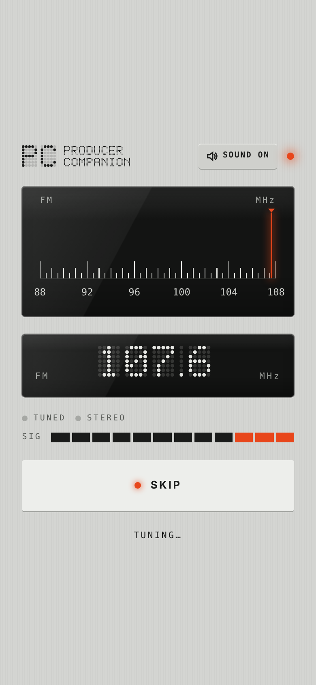
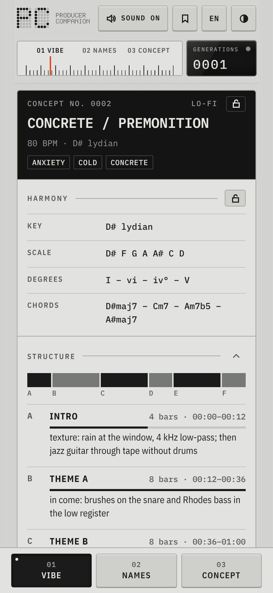
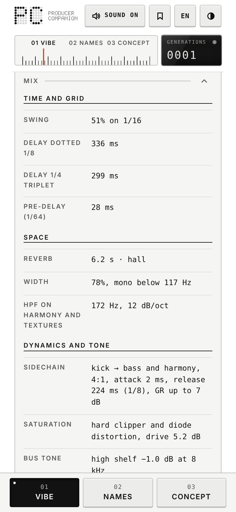
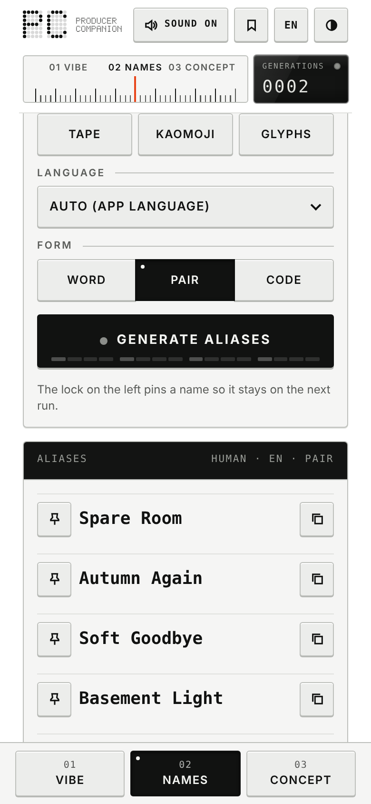
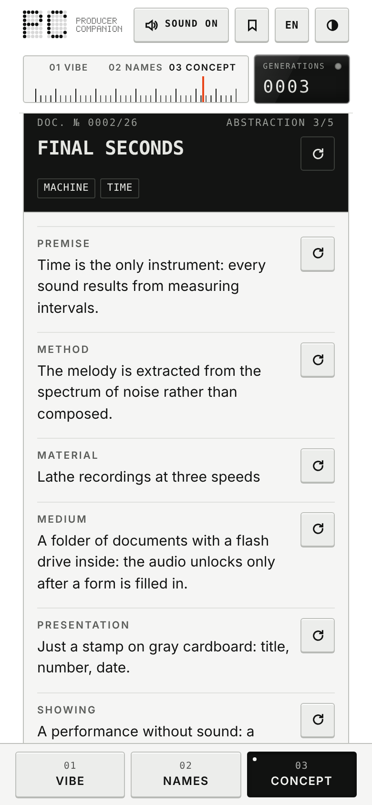
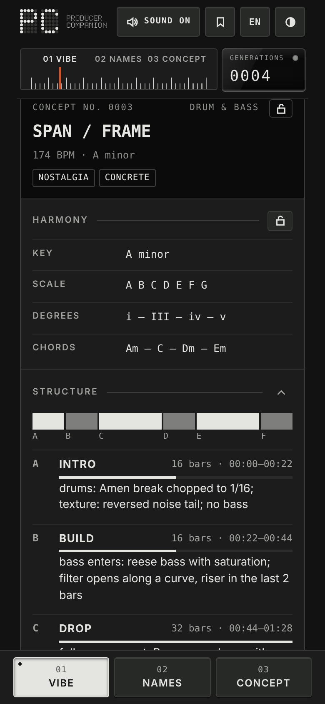
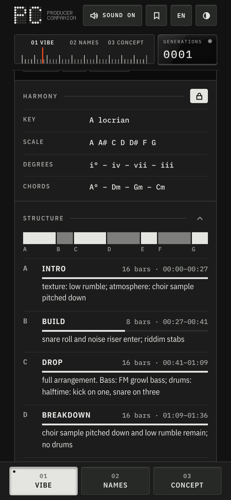
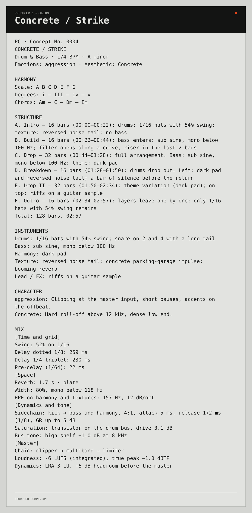
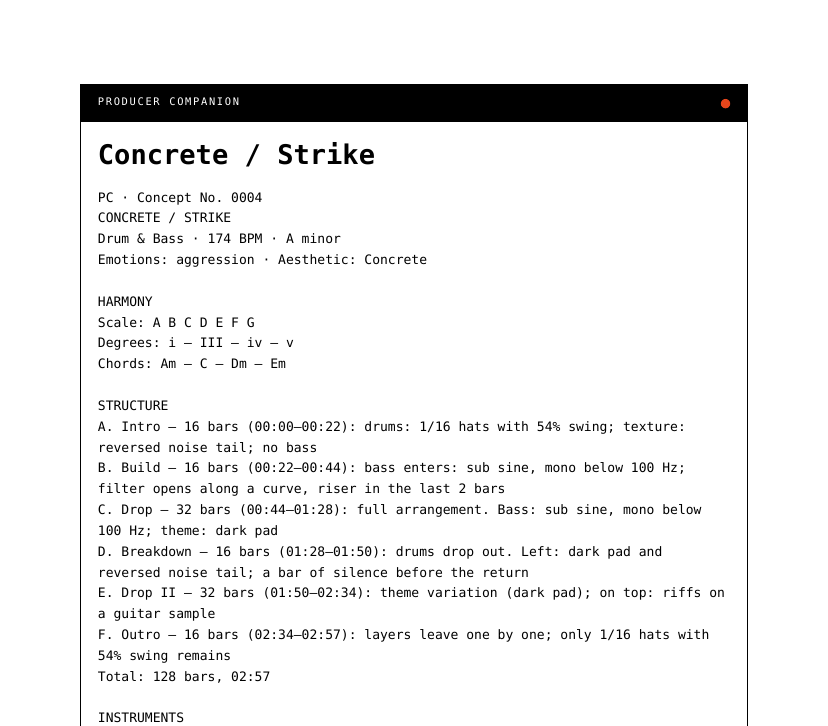
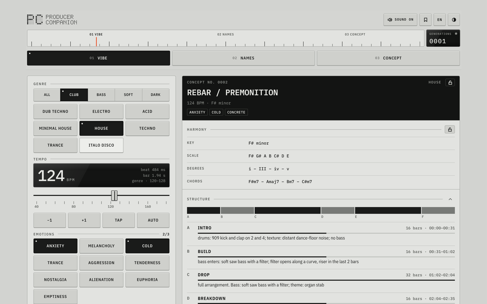

# Producer Companion

**[▶ Open the app](https://shoogaze.github.io/producer-companion/)**  ·  works in the browser, installs to the Home Screen

A single-file mobile web app for electronic music producers, styled after Braun notebooks and vintage measuring instruments: monochrome, one orange lamp, IBM Plex type, a radio-dial boot screen.

<!-- Demo: in the GitHub editor, drag extras/demo.mp4 here; it is uploaded and plays inline. -->

- **Vibe**: genre, tempo, emotions and aesthetic → track concept with structure, instruments and mixing parameters
- **Names**: stage aliases and tracklists in eight styles (Clean, Factory, Ether, Bureau, Cosmos, Tape, Kaomoji, Glyphs) and seven languages (RU, EN, ES, DE, FR, JA, ZH, or mixed), thousands of word combinations
- **Concept**: conceptual / industrial album ideas
- **Locks**: pin the harmony, the instruments or the title in a Vibe result and regenerate the rest
- **Share and print**: every result (vibe, names, tracklist, concept) exports as a **PNG picture** (on a phone it opens the system Share sheet, on a desktop it downloads) and prints as a clean one-page A4 sheet
- **Saved**: keep any result on the device (bookmark button in the header), copy or delete it later
- **Installable**: add to the Home Screen and it works offline (PWA)

28 genres · interface in RU / EN / ES / DE / FR / JA · light, grey and dark skins · radio-dial boot screen with Web Audio sounds · phone, tablet and desktop layouts.

Keys: `1`–`3` switch modules, `G` generate, `M` toggle sound.

## Screenshots

| Boot | Vibe | Mix | Names |
|---|---|---|---|
|  |  |  |  |

| Concept | Dark skin | Locks |
|---|---|---|
|  |  |  |

**Share as a picture and print on A4**

**Desktop**

## Companion project

**[Patch Companion](https://github.com/SHOOGAZE/patch-companion)** ([live](https://shoogaze.github.io/patch-companion/)) is the third app of the family: patch cards for 50 hardware synths, knob positions 0–10, by sound type and mood. The footer links all three and carries genre and tempo along.

**[Sequential Companion](https://github.com/SHOOGAZE/sequential-companion)** ([live](https://shoogaze.github.io/sequential-companion/)) is the sister app in the same design language: pattern cards for Digitakt 2 and other 16-step sequencers, 164 genre presets in 28 genres, A/B/FILL variations, MIDI export, a seeded generator, and a dot-matrix boot screen that writes a pattern instead of tuning a radio. Producer Companion gives you the idea and the structure of a track; Sequential Companion gives you the first drum pattern to start it with.

## Run

Live build: https://shoogaze.github.io/producer-companion/

Open `index.html` in a browser. No build step. For GitHub Pages: Settings → Pages → deploy from branch `main`, root.

**Install on iPhone:** open the site in Safari → Share → Add to Home Screen. It then runs full-screen and offline. Keep `manifest.webmanifest`, `sw.js` and the `icons/` folder next to `index.html`.

## License

[MIT](LICENSE) © 2026 Kirill Kinderhart
