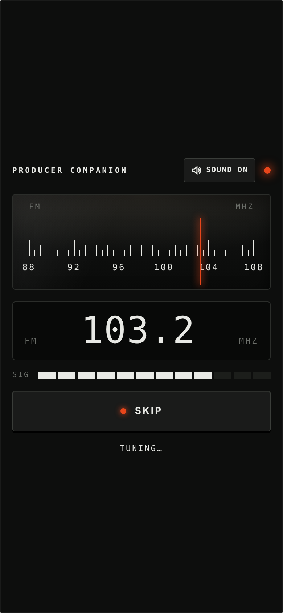
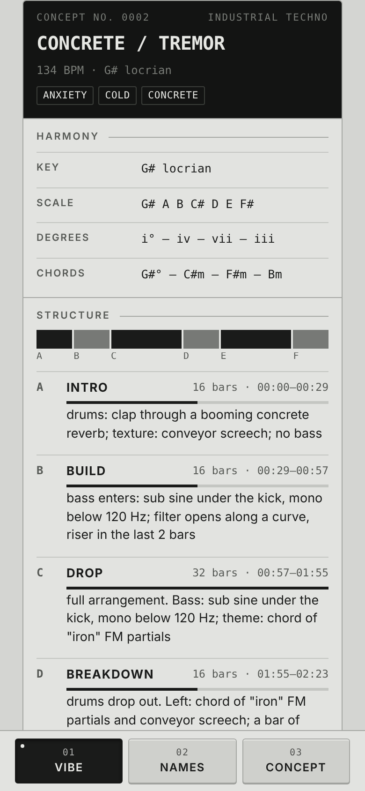
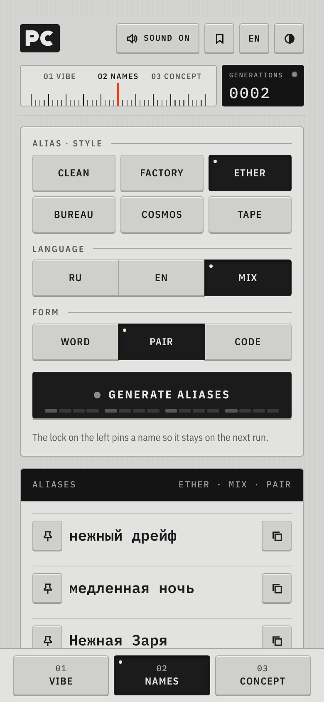
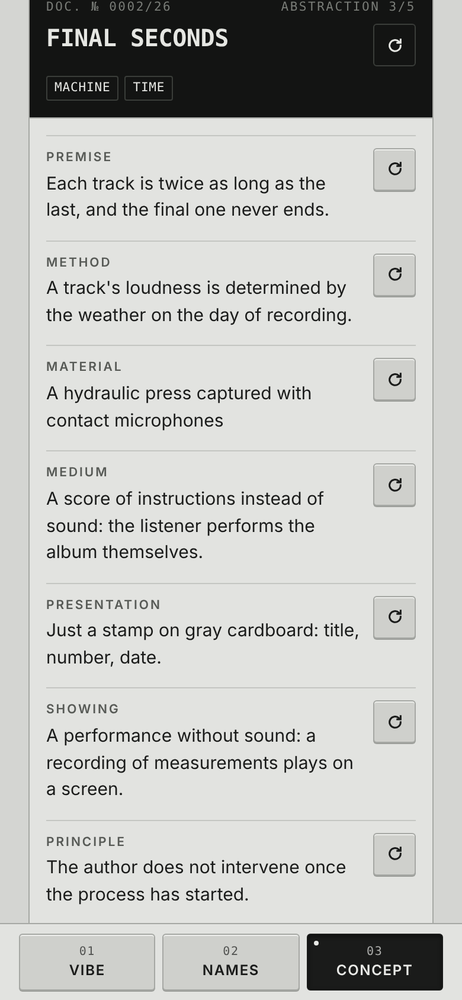
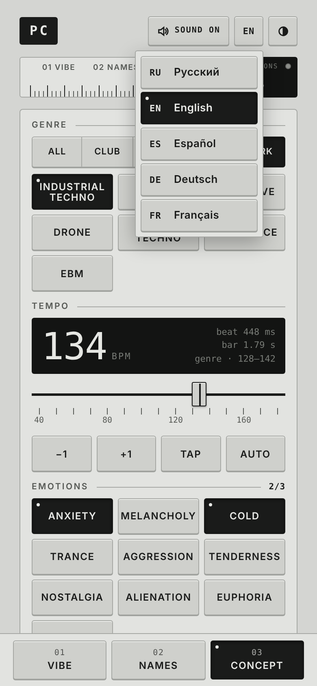
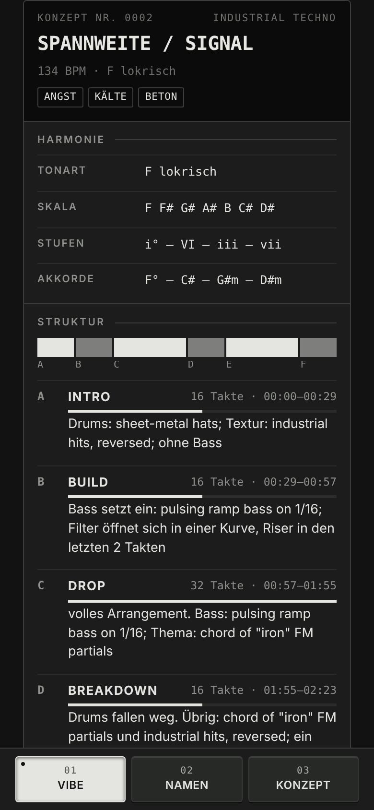
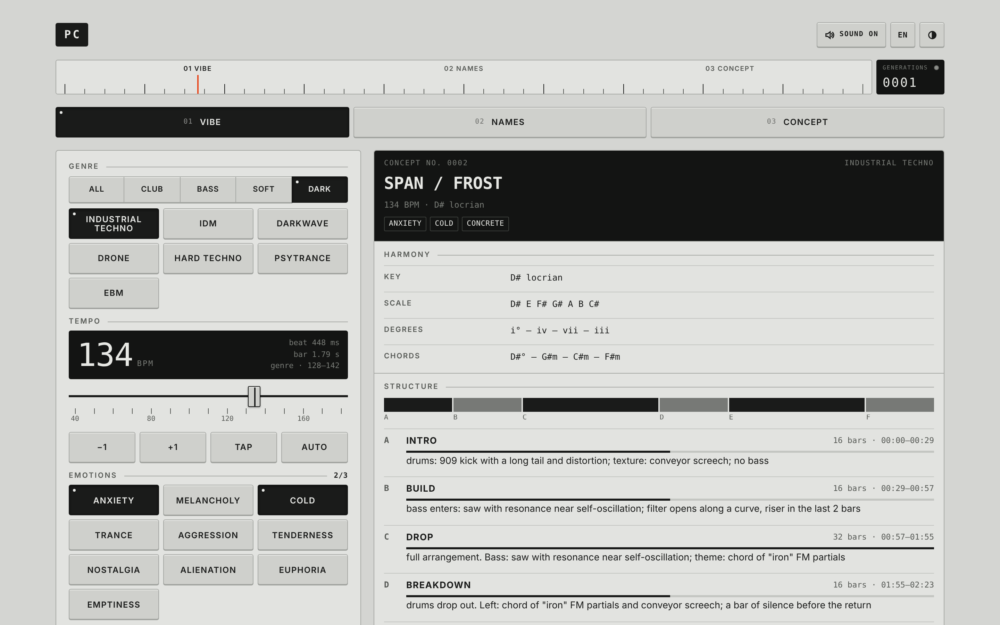

# Producer Companion

A single-file mobile web app for electronic music producers, styled after Braun notebooks and vintage measuring instruments.

- **Vibe**: genre, tempo, emotions and aesthetic → track concept with structure, instruments and mixing parameters
- **Names**: stage aliases and tracklists
- **Concept**: conceptual / industrial album ideas

28 genres · RU / EN / ES / DE / FR · light, grey and dark skins · radio-dial boot screen with Web Audio sounds · phone, tablet and desktop layouts.

Keys: `1`–`3` switch modules, `G` generate, `M` toggle sound.

## Screenshots

| Boot | Vibe | Names | Concept |
|---|---|---|---|
|  |  |  |  |

| Languages | Dark skin, German | Desktop |
|---|---|---|
|  |  |  |

## Run

Open `index.html` in a browser. No build step. For GitHub Pages: Settings → Pages → deploy from branch `main`, root.

## License

[MIT](LICENSE) © 2026 Kirill Kinderhart
